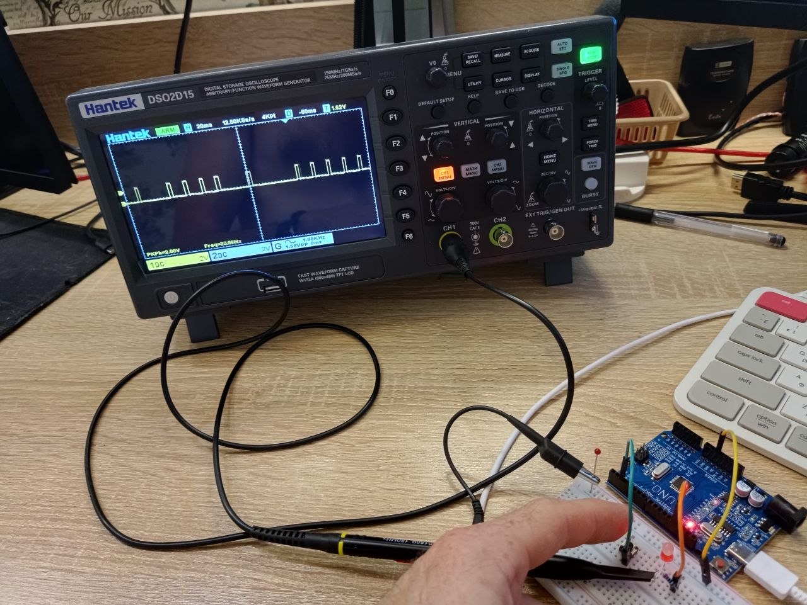
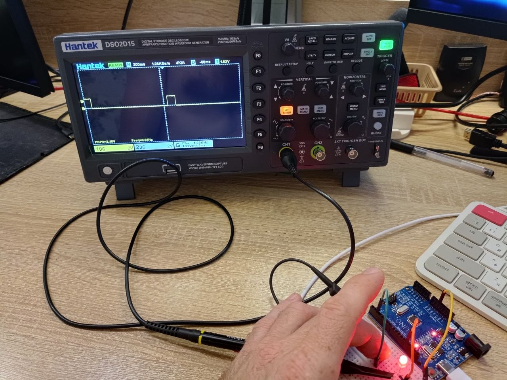

### Первое домашнее задание
 Провенено три варианта работы кнопки и светодиода:
 1. [Вариант без подтягивающего резистора и программной защиты от дребезга](hw_1/hw_1.ino)
 2. [Вариант с подтягивающим рестором](hw_1_pullup/hw_1_pullup.ino)
 3. [Вариант с подтягивающим резистором и программной защитой от дребезга](hw_1_delay/hw_1_delay.ino)

 - Для варианта без подтягивающего резистора и программной защиты на фото видны ложные срабатывания микроконтроллера на помеху (осцилограмма с контакта светодиода)
 

 ----

- Для варианта с включенным подтягивающим резистором стабильность срабатывания значительно лучше, ложные срабатывания увидеть уже сложно.
 

 ----

 - Вариант с программной защитой стабильнее чем с подтягивающим резистором, ложных срабатываний нет.