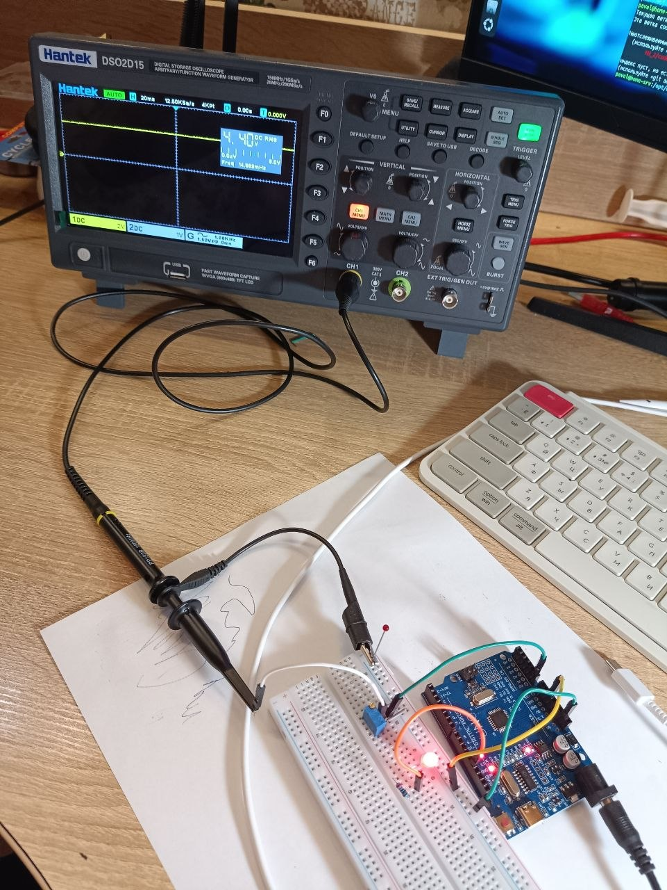
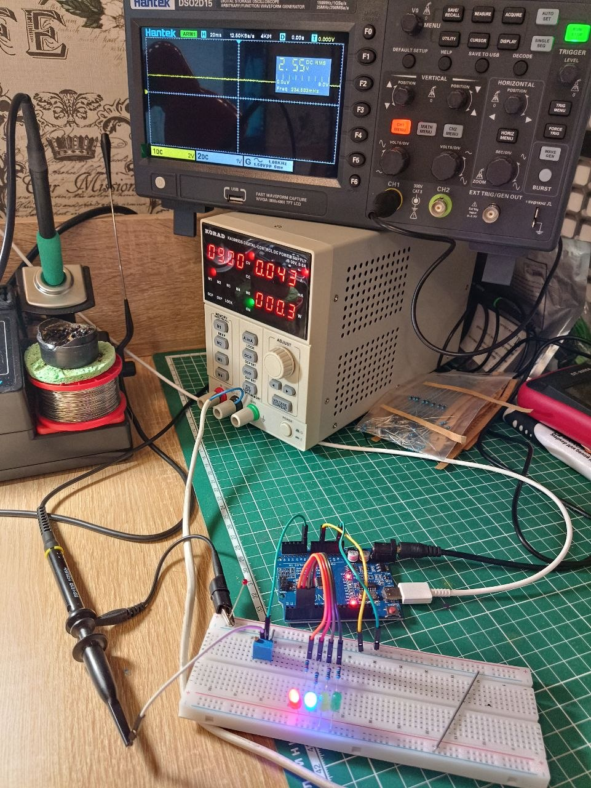
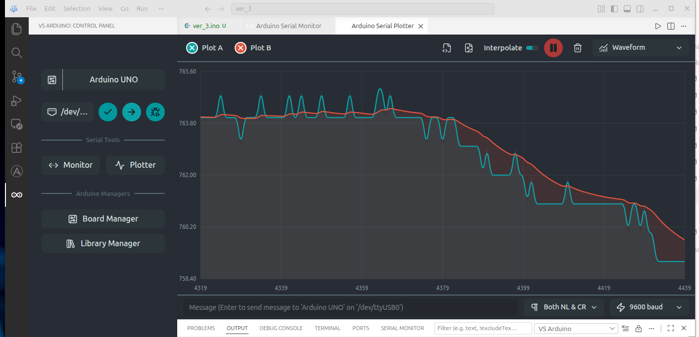
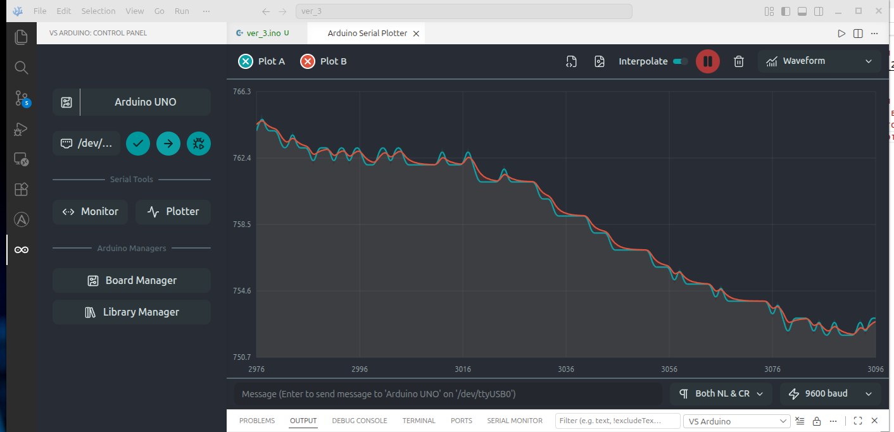

### Второе домашнее задание
 

 1. [Вариант кода с измерением напряжения на входе А0 без фильтрации](code/ver_1/ver_1.ino)  
Светодиод зажигается при напряжении на входе А0 ~ 4.4В, значение АПЦ >900

  2. [Вариант кода с "маштабированием" входного значения АЦП с входа А0 к 4 уровням (для варианта с 4 светодиодами)](code/ver_2/ver_2.ino)
  

  3. [Вариант кода с "маштабированием" входного значения АЦП с входа А0 к 4 уровням (для варианта с 4 светодиодами) и выводом в Serial порт сырого и бегущего среднего значения. На скрине с монитора порта наглядно видно как фильтруются помехи (красная линия это усреднённое значение)](code/ver_3/ver_3.ino)
  

  4. Если альфа для фильтра установить а= 0.8, сглаживание фильтром практически пропадает, ниже скрин для а=0.8
  

