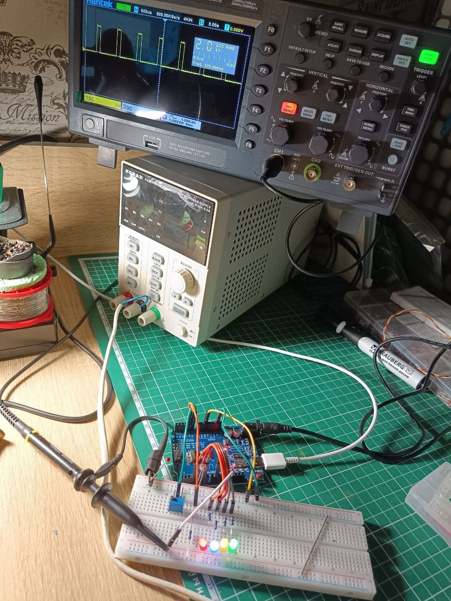
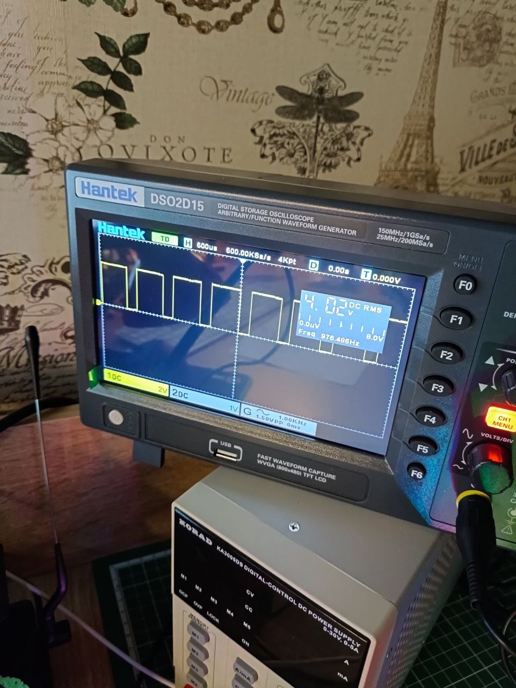

### Третье домашнее задание
 

 1. [Вариант кода с регулировкой яркости четырёх светодиодов на выходах 3, 5, 6, 9. Яркость меняется переменным резистором. На осцилограмме видно как меняется скважность импульсов. Частота ШИМ на пинах 5, 6 и 3, 9 отличается, на пинах 5,6 = 976 Гц, на 3,9 = 490 Гб](code/ver_1/ver_1.ino)
 На фото видно осцилограмму снятую со светодиода в разных положениях резистора.

 

 

  