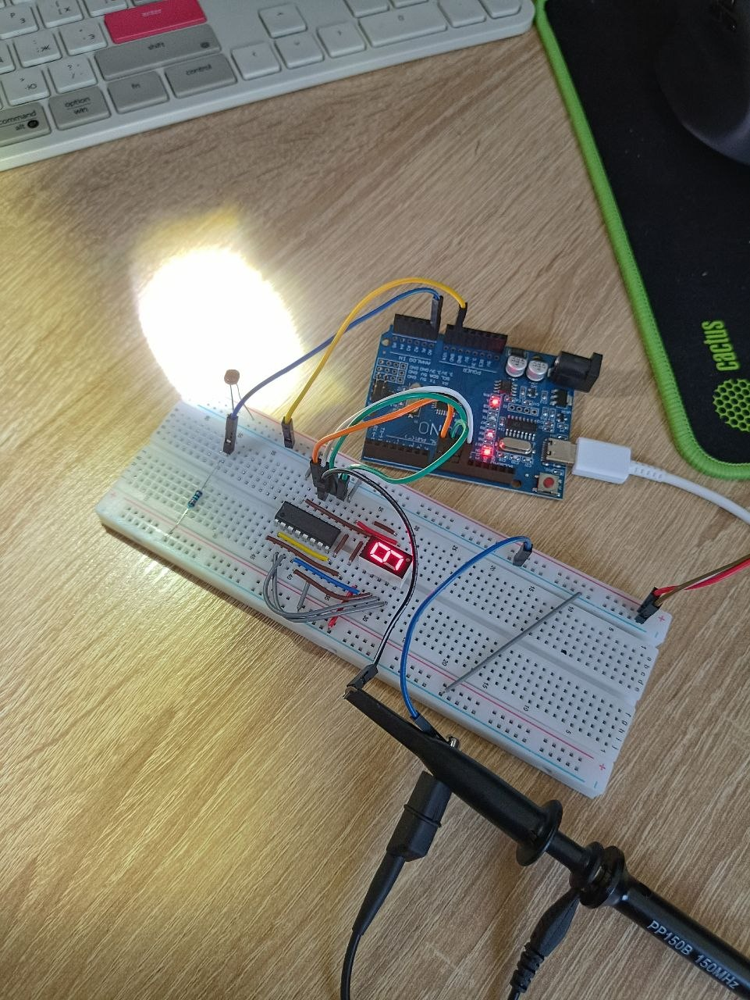
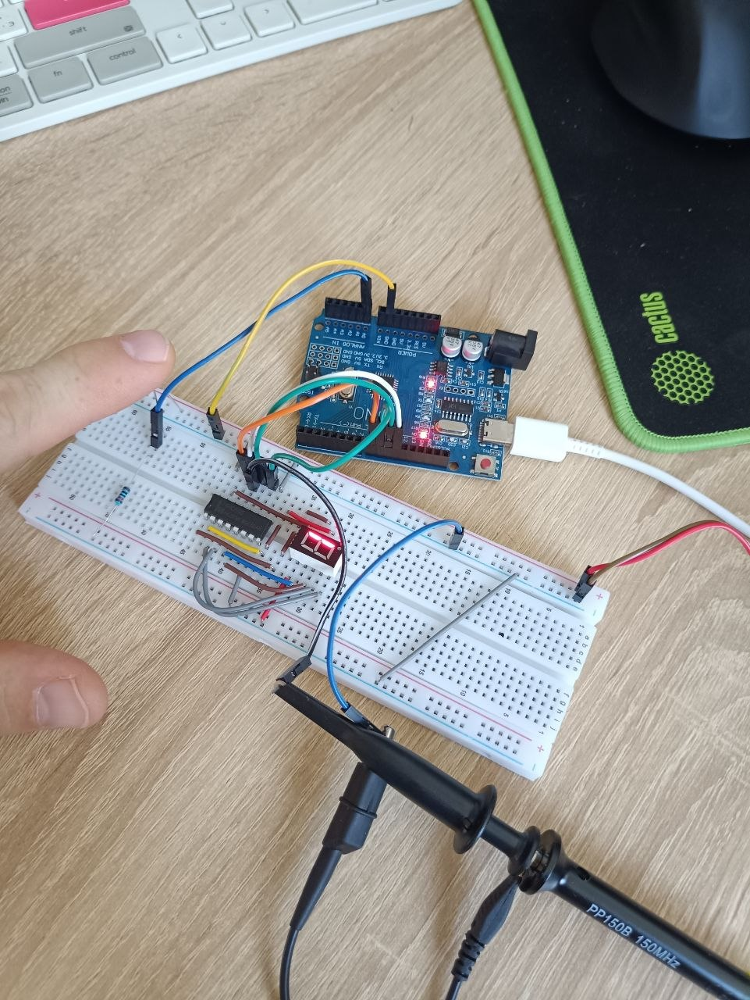

### Четвёртов домашнее задание
 
 1. [Вариант кода для управления семисегментным индикатором FYS-3611 через сдвиговый регистр 74HC595, реализован вывод величины освещённости фоторезистора на индикатор, максимальная освещённость - цифра 9, минимальная овещённость цифра 0. Для отладки в serial порт выводится значение с фоторезистора и значение на индикаторе. Управление яркостью индикатора реализована через ШИМ на входе OE микросхемы 74HC595](code/ver_1/ver_1.ino)

 На фото можно увидеть значение индикатора при отсутствии освещённости и при максимальной освещённости
  
  
