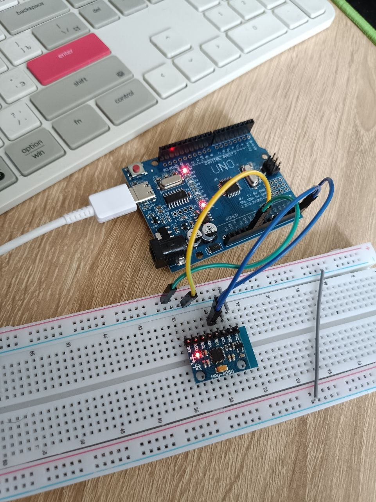

### Пятое домашнее задание
 
 1. [Вариант кода для определения адреса датчика на I2C шине](code/ver_1/ver_1.ino)
 2. [Вариант кода для опроса датчика MPU-6050, выводи в serial порт данные акселерометра, гироскопа и температуры](code/ver_2/ver_2.ino)

 На фото представлена схема подключения
 
 
 