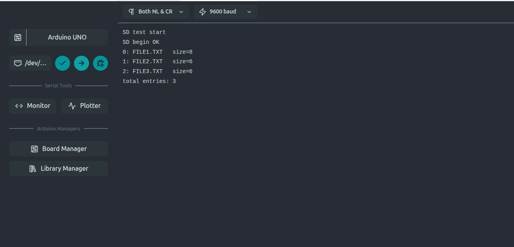
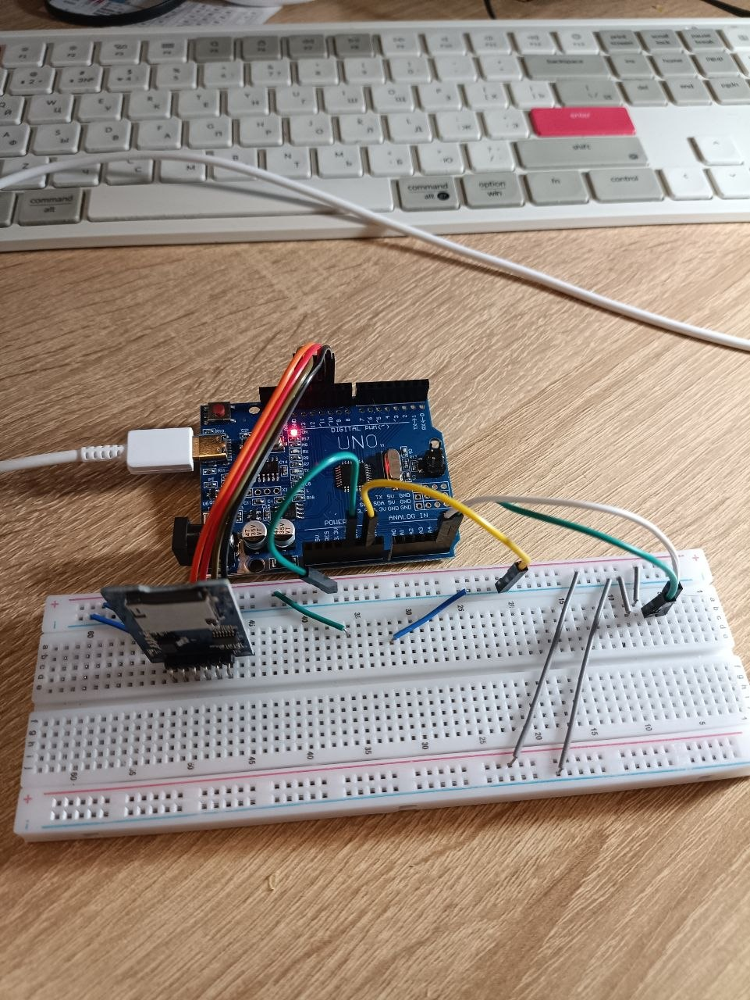
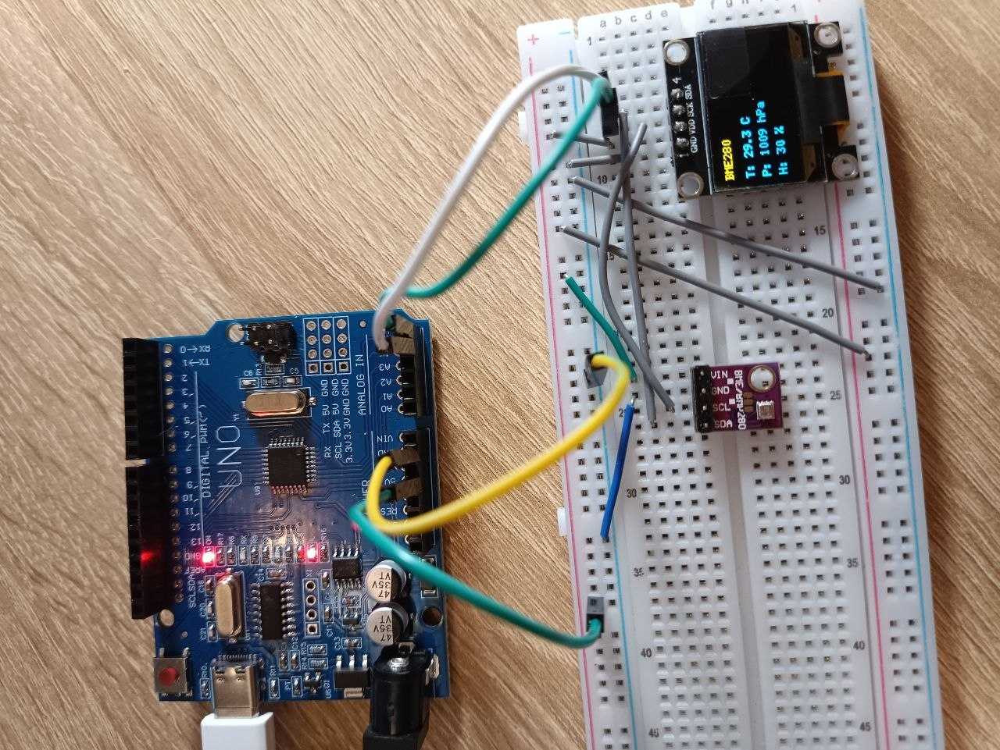

### Шестое домашнее задание
 
 1. [Код для вывода содержимого SD карты (SPI) в serial порт, на карте были созданы три файла file1.txt, file2.txt, file3.txt, скетч успешно вывел содержимое карты в serial порт, проверили работу протокола SPI](code/ver_1/ver_1.ino)
 2. [Код метеостанции, выводит показания датчика BME280 на OLED экран, температуру, давление, влажность. Датчик и экран работают по протоколу I2C и подключены физически к одной шине, но имеют разные адреса](code/ver_2/ver_2.ino)

 На первом фото представлен вывод списка файлов на SD карте через Serial порт.
 

 На втором фото представлена собранная схема подключения SD карты к UNO плате.
 

 На третьем фото представлена собранная схема подключения датчика BME280 и OLED экрана к плате UNO
 
 