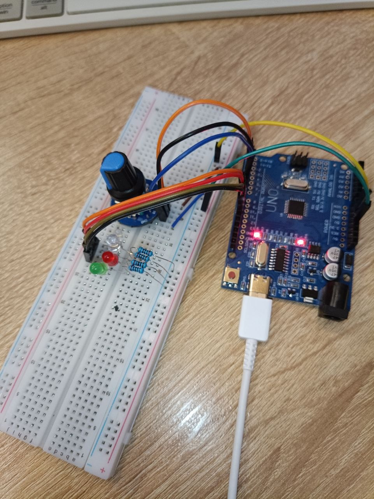

### Восьмое домашнее задание
 
 Управление светодиодами через регистры. Управление осуществляется с помощью энкодера. Вращение в одну сторону увеличивает кол-во включенных светодиодов, вращение в противоположную сторону уменьшает кол-во включенных светодиодов. Нажатие кнопки энкодера выключает все светодиоды.  
 [**Код программы**](code/ver_1/ver_1.ino)

 Фото собранной платы:
 

 Видео демонстрации работы загрузил на google disk:
 [Ссылка на видео](https://drive.google.com/drive/folders/10op3hyx8lTEwc_TOPcklGk3Vy-lWiTCH?usp=drive_link)
 