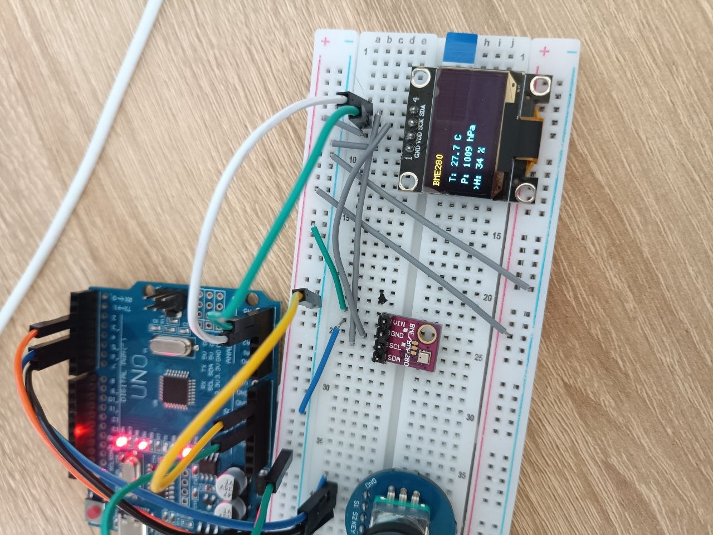
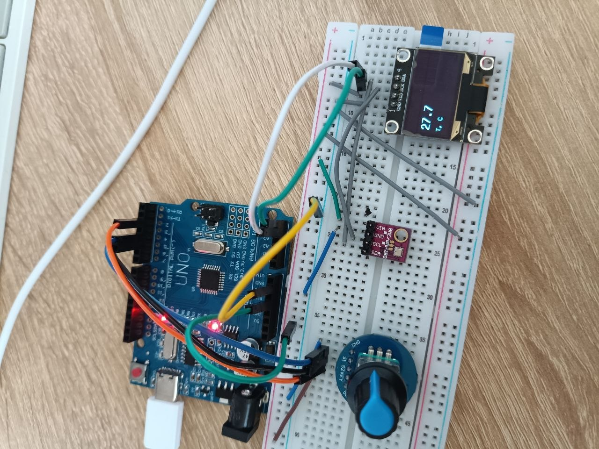
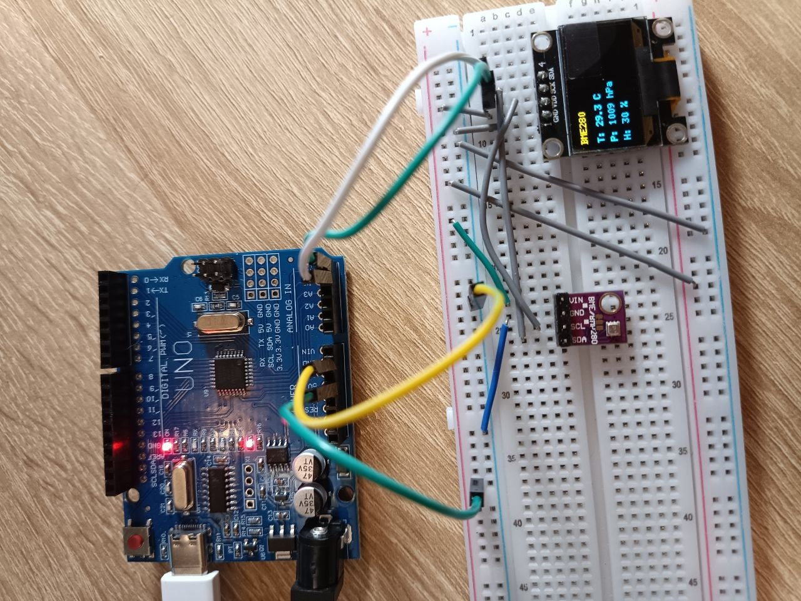

# Курсовая работа. Настольная метеостанция

**Курс «Инженер умных систем»**
Модуль «Проектирование устройств» (Arduino)

Вариант 1 из перечня курсовых работ (лекция 8).

## 1. Цель и постановка задачи

В перечне курсовых работ (лекция 8) вариант 1 — настольная метеостанция.
Обязательные требования: получение данных с датчика и вывод данных на дисплей;
остальной функционал — по желанию. Проект построен на базе домашних заданий 6 и 7
и представляет собой законченное устройство: считывание температуры, давления и
влажности с датчика BME280, отображение их на OLED-дисплее и управление выводом
с помощью энкодера с кнопкой.

Итог работы — собранное и работающее устройство, выводящее показания датчика на
экран в двух режимах, фото и код которого приведены в отчёте по заданию 7.

## 2. Аппаратная часть и подключение

Платформа — Arduino UNO (микроконтроллер ATmega328P). Состав и подключение
периферии приведены в таблице 1.

| Компонент | Модель | Интерфейс | Подключение |
| :-- | :-- | :-- | :-- |
| Плата | Arduino UNO | — | — |
| Датчик T/P/H | BME280 | I2C | SDA=A4, SCL=A5, 0x76 |
| Дисплей | OLED SSD1306 128x64 | I2C | SDA=A4, SCL=A5, 0x3C |
| Энкодер с кнопкой | KY-040 | GPIO | CLK=D4, DT=D5, KEY=D2 |

*Таблица 1. Состав устройства и назначение выводов.*

Датчик и дисплей подключены к одной шине I2C параллельно, их различают по адресам
(0x76 и 0x3C). Кнопка энкодера подключена к выводу D2, который на UNO является входом
внешнего прерывания INT0; она активна низким уровнем (питание — через внутреннюю
подтяжку INPUT_PULLUP).

## 3. Программная реализация

### 3.1. Состав и работа с периферией

Использованы библиотеки Wire (шина I2C), Adafruit_BME280 (датчик), U8g2 (дисплей) и
math. Дисплей работает в страничном режиме (конструктор с суффиксом `_1_`), что убирает
полноэкранный буфер из кучи и экономит ОЗУ на ATmega328P. Датчик опрашивается в режиме
FORCED (измерение по запросу) с периодом 500 мс; показания сохраняются в переменные
текущей температуры, давления и влажности.

### 3.2. Два режима отображения

В основном режиме на дисплей выводятся три строки — температура, давление и влажность;
выбранная строка помечена символом «>». Поворот энкодера перемещает выбор между
строками. Нажатие кнопки переключает во второй режим, где выбранный параметр
показывается крупным шрифтом; повторное нажатие возвращает режим трёх показателей.

### 3.3. Обработка кнопки через прерывание

Нажатие кнопки энкодера обрабатывается аппаратным прерыванием по спадающему фронту
(`attachInterrupt(..., FALLING)`). Обработчик прерывания не выполняет никакой работы,
кроме установки флага volatile-переменной: внутри ISR запрещены блокирующие операции и
обращения к шине I2C/дисплею. Переключение режима выполняется уже в главном цикле по
этому флагу. Флаг объявлен `volatile`, иначе компилятор мог бы закэшировать его значение
и не заметить изменения из прерывания.

### 3.4. Обработка вращения энкодера

Вращение энкодера опрашивается в главном цикле (без прерывания). Направление
определяется по состоянию второй линии (DT) в момент изменения первой (CLK). Для
защиты от дребезга механического энкодера принятый шаг фильтруется паузой по `millis()`.
Опрос в цикле здесь допустим, потому что главный цикл не занят длительными
блокирующими операциями.

### 3.5. Форматирование чисел

В среде AVR функция `snprintf` не поддерживает спецификатор `%f`, поэтому числа с
десятичной точкой формируются вручную: берётся модуль значения, целая часть и первая
цифра дробной части, отдельно обрабатывается перенос при округлении. Такой приём
позволяет корректно выводить, например, 0.96 как «1.0», а не обрезать до 0.9.

## 4. Результаты работы

Ниже приведены фотографии собранного устройства. На первой — основной режим с тремя
показателями (температура, давление, влажность), на второй — режим крупного вывода
одного выбранного параметра, полученный после нажатия кнопки энкодера.

*Рисунок 1. Основной режим: три показателя датчика на OLED.*

*Рисунок 2. Режим крупного вывода выбранного параметра (после нажатия кнопки).*

*Рисунок 3. Подключение датчика BME280 и OLED-дисплея к плате UNO (шина I2C).*

## 5. Выводы

В ходе курсовой работы собрано настольное устройство измерения микроклимата,
объединяющее ранее выполненные задания: работу с датчиком и дисплеем по шине I2C,
вывод данных на экран и обработку энкодера с кнопкой. Устройство в реальном времени
показывает температуру, давление и влажность и позволяет выбрать способ отображения.
В работе закреплены практические приёмы: совместная работа нескольких устройств на одной
шине I2C, аппаратное прерывание с volatile-флагом, антидребезг энкодера и подготовка
числовых данных для вывода на экран без поддержки плавающей точки в `printf`.

Возможные направления развития: вывод дополнительных параметров, сохранение истории
измерений на SD-карту (интерфейс SPI) или подключение модуля реального времени для
отметок времени замеров.
